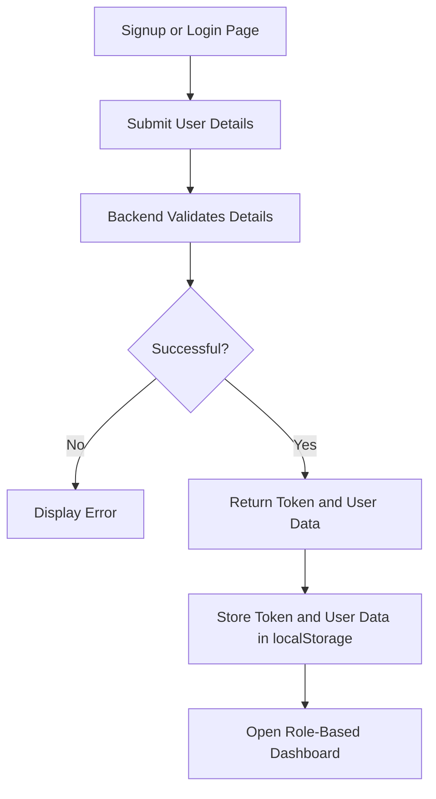
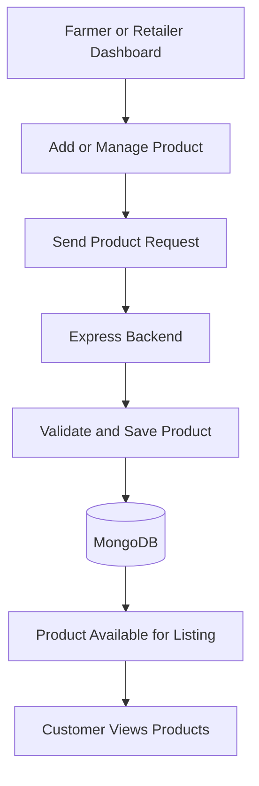
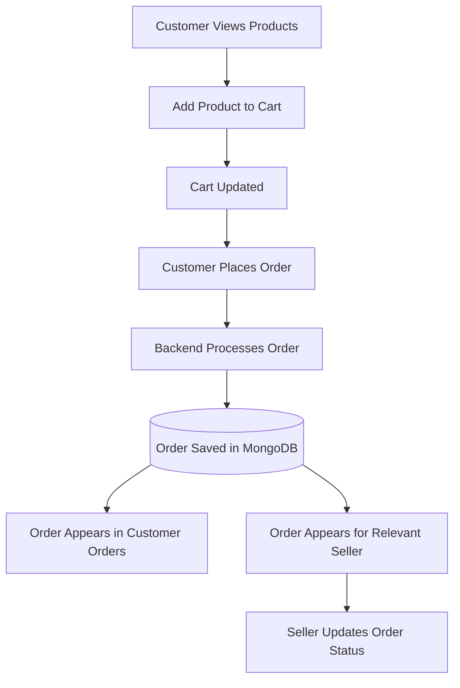
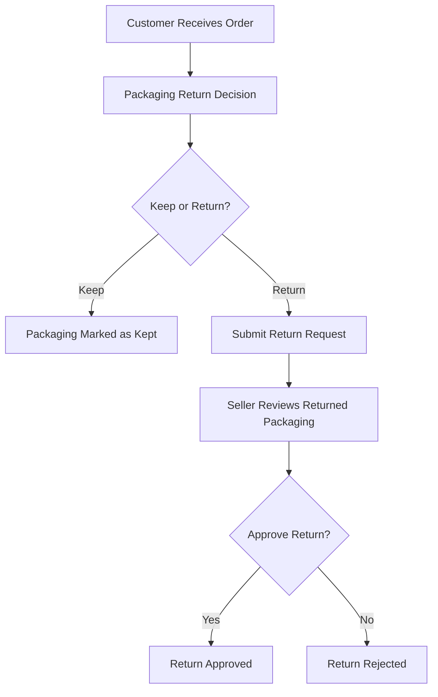

# FarmCart — Project Workflow

## 1. Authentication Workflow

## 2. Product Workflow

## 3. Cart and Order Workflow

## 4. Returnable Packaging Workflow

## Note

These diagrams provide a high-level overview of FarmCart workflows. Exact behavior may vary by endpoint and role.